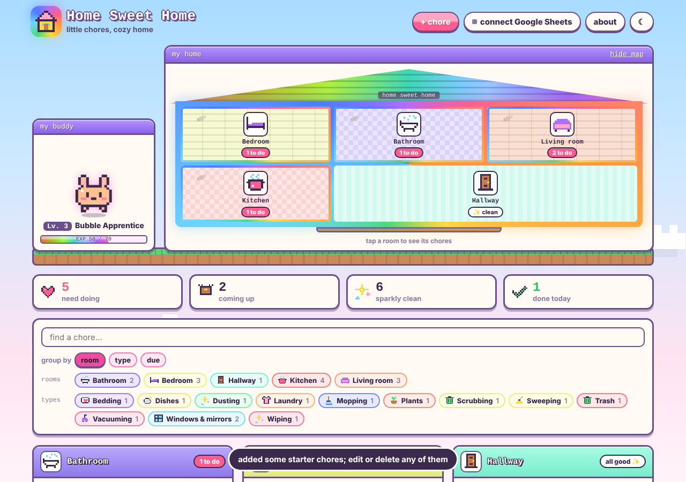

# Home Sweet Home

*Little chores, cozy home.*

Home Sweet Home is a small website for keeping track of the chores around your home: what needs
doing, which room it is in, what kind of task it is, and when you last did it.



**Use it:** <https://gkim65.github.io/homesweethome/> (once GitHub Pages is turned on, see below)

## What it does

- **Chores, grouped your way.** Type in any chore, give it a **room** (Kitchen, Bedroom,
  Bathroom, Hallway, …) and a **type** (Mopping, Sweeping, Windows & mirrors, Laundry, …), and
  group the board by room, by type, or by how due things are. Rooms and types are free text, so
  "Linen closet" or "Descaling" work too.
- **Little pixel icons.** Rooms and types get a pixel-art icon picked from keywords in the name
  (a pot for kitchens, a mop for mopping, a shirt for laundry…), and each room and type keeps its
  own rainbow colour. Anything unrecognised gets a sparkle or a little house.
- **When you last did it.** Tap ✓ to mark a chore done today (tap again, or *undo*, to take it
  back). Open a chore to log a different date or remove one. Every "done" is kept as a dated row,
  so the sheet holds your full history.
- **What is due.** Give a chore a schedule (daily, weekly, every 10 days, …) and its dust meter
  fills as the days pass. Due and overdue chores get a turning RGB border. Chores with no schedule
  are "whenever".
- **Filter and search.** Light up one or more room or type chips, or search names and notes.
- **Your home map.** A little pixel house sits in the middle of the page with a tile for each
  room. Each tile has its own floor (tiles, wood, carpet or grass). Rooms with chores due get a
  turning RGB frame and dust puffs, and clean rooms twinkle. Tap a room to see only its chores (tap
  again to see everything). *hide map* tucks it away.
- **Bun, your cleaning buddy.** An RGB dust bunny who hops about and cheers whenever you finish a
  chore ("omg great job!! You finished 3 chores today! You should…"). If you have scrolled down,
  Bun pops up in the corner instead. Tap Bun to say hi. The encouragements are written for this
  app; they are not quotes from anyone.
- **Levels and EXP.** Every chore done is +10 EXP. Fill the bar to level up, from *Dust Bunny
  Rookie* to *Legend of Sparkle*. Your level is worked out from the History tab, so it is the same
  on every device.

## Your data and privacy

This works the same way as [Kith](https://github.com/gkim65/kith):

- Your chores are stored in **a Google Sheet in your own Google Drive** ("Home Sweet Home
  chores"), and in your browser so the site works offline. There is no server, no database, and no
  analytics.
- The app asks Google only for the `drive.file` permission, which lets it open **only files it
  created**, nothing else in your Drive. It never shares the sheet.
- The sign-in token is kept in the open page's memory only and expires after about an hour.
- Everything you type is shown as plain text, never run as code, and is written to the sheet as
  plain values (so text starting with `=` is never treated as a formula).
- A Content Security Policy only lets the page load code from itself and Google's sign-in script,
  and only talk to Google's APIs.

### How syncing keeps data safe

Every change is saved in your browser first. Syncing then reads the sheet, merges it with your
browser's copy, and writes the result back in one request. The merge compares both sides with the
last version they agreed on, so changes made in the sheet by hand, in another browser, or here are
all kept. When the same chore was changed differently in two places, this browser's version is kept
and the other is added to a **Backups** tab in the sheet. A sync that would remove more than half
your chores stops and asks first. Google Sheets' own version history (File > Version history) is
a final safety net.

### Editing the sheet by hand

| Tab | Columns |
|---|---|
| `Chores` | `id`, `chore`, `room`, `type`, `every_days`, `last_done`, `notes` |
| `History` | `id`, `chore_id`, `date`, `chore (name)`, `room (name)` |
| `Settings` | `key`, `value` |

- Add a row to **Chores** with just a name (leave `id` empty) and it gets an id on the next sync.
- Type a newer date into `last_done` and it is logged as a new "done" in History.
- In **History** you can type a chore's *name* in `chore_id`; it is matched to that chore.
- `last_done`, `chore (name)` and `room (name)` are filled in for you to read; the source of truth
  for dates is the History tab. To remove a "done", delete it in the app (or delete the History
  row *and* clear that chore's `last_done`).
- Columns are matched by their headers, and columns you add yourself are kept.

## Turning on GitHub Pages

In this repository on GitHub: **Settings > Pages > Build and deployment**, choose *Deploy from a
branch*, pick `main` and `/ (root)`, and save. The site appears at
`https://gkim65.github.io/homesweethome/` after a minute or two.

## Google sign-in setup

The client ID in [js/google.js](js/google.js) is the same one Kith uses. Google's *Authorized
JavaScript origins* list a scheme and host (no path), so if `https://gkim65.github.io` is already
listed for Kith, this site's sign-in should work without changes. You also need the **Google
Drive API** and **Google Sheets API** enabled in that Google Cloud project (Kith needs them too).

To use your own Google Cloud project instead:

1. In [Google Cloud Console](https://console.cloud.google.com/), create a project.
2. Under **APIs & Services > Library**, enable the **Google Drive API** and the **Google Sheets API**.
3. Set up the **OAuth consent screen**. While the app is in *Testing* mode, only the Google
   accounts you add as test users can sign in.
4. Under **APIs & Services > Credentials**, create an **OAuth client ID** of type *Web
   application*, and add the addresses you will serve the site from under **Authorized JavaScript
   origins** (for example `http://localhost:8765` and `https://<you>.github.io`).
5. Put your client ID in `CLIENT_ID` at the top of [js/google.js](js/google.js).

## Running it locally

Plain HTML, CSS and JavaScript with no build step:

```sh
python3 -m http.server 8765
```

then open <http://localhost:8765> (use `localhost`, not `127.0.0.1`: Google treats them as
different addresses). After changing code, hard reload (Cmd+Shift+R).

## Files

| Path | What it holds |
|---|---|
| `index.html` | page layout, dialogs, security policy |
| `css/style.css` | light (day sky) and dark (night sky) themes, game-window panels, RGB borders, animations, phone layout |
| `js/main.js` | the board, editor, marking chores done, wiring |
| `js/homemap.js` | the little house map |
| `js/mascot.js` | Bun, the cheers, floating EXP and the level-up banner |
| `js/dom.js` | building page elements safely |
| `js/icons.js` | the pixel-art icons and which room/type gets which |
| `js/store.js` | the data shape, due dates, saving in the browser |
| `js/sync.js` | the three-way merge and sync loop |
| `js/sheet.js` | reading and writing the Google Sheet |
| `js/google.js` | Google sign-in |

## Credits

Made by [Grace](https://gkim65.github.io) with help from Claude. Uses the Silkscreen and Nunito
typefaces from Google Fonts.
